# Chimera

**A model-agnostic, local-first general-purpose AI computer agent.**

Chimera is designed to understand and execute complex tasks across your digital environment: general computer and application control, software engineering, authorized cybersecurity research, technical analysis, and governed self-learning. It aims to become an extensible intelligence layer that operates with explicit operator control, local-first by default, and governed execution at every step.

---

## Vision & Philosophy

Chimera is not a chatbot or a coding assistant. It is an agent platform that:

- **Remains model-agnostic** — Switch between local GGUF models, OpenAI, Anthropic, Gemini, Meta, or custom providers without changing your workflow.
- **Prioritizes local-first** — Run inference locally when possible; remote providers are explicit choices, never silent fallbacks.
- **Governs all execution** — Every tool call, application action, and system modification passes through approval gates with full audit trails.
- **Learns from experience** — Capture execution traces, extract reusable skills, and promote them with operator approval.
- **Integrates applications** — Connect to specialized tools (IDEs, browsers, build systems, analysis tools) through a governed Application SDK.
- **Reverse-engineers software** — REA provides binary and artifact analysis as one specialized capability domain.

Chimera does not claim to be a completed AGI or frontier model equivalent. It is a foundation for building capable, transparent, and controllable AI agents.

---

## Key Capabilities

| Capability | Status |
|------------|--------|
| **Multi-provider inference** | ✅ Implemented — 8 provider adapters (OpenAI, Anthropic, Gemini, Meta, llama.cpp, Custom) |
| **Local GGUF inference** | ✅ Implemented — llama.cpp integration with explicit model configuration |
| **AgentRuntime & session persistence** | ✅ Implemented — SQLite-backed sessions, messages, and events |
| **Persistent goals & ambitions** | 🟡 Initial implementation — local SQLite ledger, operator-controlled lifecycle, success criteria, priorities, evidence references and local-only reasoning context |
| **Workspace tools (read/write)** | ✅ Implemented — Governed file operations with approval gates |
| **Computer use (Windows)** | 🟡 Partial — operator-authorized process sessions, fresh UIA references and exact semantic patterns; global keyboard/mouse injection is disabled |
| **Application SDK** | ✅ Implemented — Universal connector framework with risk levels |
| **REA: Reverse Engineer Anything** | ✅ Implemented — Artifact detection, static analysis, Ghidra integration |
| **Ghidra integration** | 🟡 Partial — Installation discovery and bounded static parsing; automated headless analysis actions remain unavailable |
| **Experience learning** | 🟡 Partial — Trace capture, secret redaction, stored skill proposals and approval status updates; replay and promotion remain planned |
| **Task planning** | 🟡 Implemented foundation — dependency-aware sequential templates, AgentRuntime-governed execution, permission checks and approval pause/resume; model-driven planning and parallel execution remain planned |
| **Application connectors** | 🟡 Foundation — Ghidra and REA connectors, ecosystem extensible |

---

## REA: Reverse Engineer Anything

**REA is one specialized capability domain within Chimera.**

REA stands for Reverse Engineer Anything. It is NOT Cockos REAPER (the audio workstation). REA provides Chimera with the ability to understand software artifacts, binaries, firmware, file formats and application internals through multiple analysis backends.

### What REA Does

**Artifact Detection**
- Progressive identification of PE (Windows), ELF (Linux), Mach-O (macOS), .NET, APK, DEX, firmware images, archives, and static libraries
- Format detection from byte signatures and structural headers
- Architecture and endianness identification (x86, x86_64, ARM, AArch64, MIPS, RISC-V)
- Target OS detection where available

**Built-in Static Analysis**
- Zero-dependency Python parsers for PE32, PE32+, ELF32, ELF64
- Hash calculation (SHA-256, MD5, SHA-1)
- ASCII and UTF-16LE string extraction with file offsets
- Section and header inspection with entropy analysis
- Export and import symbol enumeration
- Symbol table parsing (symtab, dynsym)
- Safe bounds checking — malformed files fail gracefully

**Backend Architecture**
- Modular adapters for specialized tools:
  - **Ghidra** — NSA Ghidra SRE Suite (headless analysis, decompilation)
  - **radare2** — radare2 reverse engineering framework (discovery-only, governed)
  - **Rizin** — Rizin binary analysis framework (discovery-only, governed)
- Backend capability manifests declare supported operations
- Engine selects appropriate backend per capability
- Missing backends report clear status rather than fabricating success

**Application SDK Integration**
- REA exposed through `ReaConnector` with governed actions:
  - `analyze_artifact` — Comprehensive static analysis
  - `extract_strings` — String extraction
  - `detect_format` — Format identification
  - `analyze_unknown` — Progressive unknown binary analysis
  - `run_ghidra_headless` — Ghidra headless execution (Level 2, requires approval)
  - `list_backends` — Backend enumeration
- All actions pass through AgentRuntime permissions and approval pipeline

**Security Controls**
- Never automatically executes imported binaries
- Strict file-size limits (150MB default)
- Bounded string scanning (4MB max, 2000 strings)
- Path validation with optional root restrictions
- Read-only analysis by default
- Subprocess timeouts (60 seconds)

### What REA Does Not Do

- REA does not claim complete parsing for every detected format
- Ghidra, radare2, and Rizin require their respective installations for external analysis
- Dynamic analysis capabilities are not yet implemented
- Automatic decompilation requires native Ghidra and JDK 17+

---

## Universal Model-Provider Architecture

Chimera's provider registry supports 8 adapter types through a unified interface:

**Supported Protocols**
- OpenAI-compatible APIs (Azure, DeepSeek, local vLLM, etc.)
- OpenAI Responses API
- Anthropic Messages API
- Gemini Content API
- Gemini Interactions API
- Meta Model API (Muse Spark; requires credentials)
- llama.cpp (local GGUF models)
- Custom adapters via SDK

**Meta Model API Tool Integration**
- Muse Spark is an optional, explicitly selected hosted provider; it is not a local model and is never a silent fallback.
- Tool schemas include eligible workspace, computer and discovered application-connector actions.
- Meta returns a proposed tool call; AgentRuntime still validates the registered action, risk, mode, permission and approval before execution.
- Tool-call arguments and their actual results are preserved as a valid provider conversation history for subsequent reasoning turns.
- Usage accounting and the Standard data-use header are applied by the Meta provider.
- CI tests use a local mock API server to verify the protocol and AgentRuntime dispatch. A live Meta request still requires a valid API credential and network access.

**Features**
- SSRF protection: DNS rebinding protection, 0.0.0.0 rejection, IPv4-mapped IPv6 blocking
- Capability detection via provider compatibility lab
- Usage accounting and token tracking
- Type-validated adapter SDK (`chimera_provider_sdk/`)
- No silent cloud fallback — model selection is always explicit

**Local Inference**
- Recommended persistent mode: configure `CHIMERA_MODEL_PATH` (GGUF) and `CHIMERA_LLAMA_SERVER` (llama.cpp server). Chimera starts the selected server at app launch, binds it to loopback, and keeps the model resident for the session.
- Explicit one-shot mode: configure `CHIMERA_MODEL_PATH` and `CHIMERA_LLAMA_CLI` without selecting a server. The CLI loads the GGUF for each request and is visibly labelled as one-shot mode.
- Runtime selection is strict: a selected server failure fails the request. Chimera does not switch to CLI, another local model, or a hosted provider.
- Tuning: `CHIMERA_MODEL_CONTEXT`, `CHIMERA_MODEL_MAX_TOKENS`, `CHIMERA_MODEL_TIMEOUT`, `CHIMERA_MODEL_THREADS`, `CHIMERA_MODEL_GPU_LAYERS`
- For a compact 3B model, Q4_K_M is a balanced quality/memory starting point; Q5_K_M may improve fidelity but consumes more memory. Quantization is part of the GGUF file, not a runtime conversion.
- Model weights are never downloaded automatically. Use the Model Bay to select a model and runtime explicitly.
- Run `python -m chimera.smoke_test` or **VERIFY AGENT PROTOCOL** to test real local inference without fake success.

---

## Application Integration Ecosystem

The Application SDK provides a universal framework for connecting Chimera to external software.

**Connector Architecture**
- `BaseApplicationConnector` — Abstract base for all integrations
- `ApplicationManifest` — Declares capabilities, risk levels, and permissions
- `ApplicationAction` — Individual operations with argument schemas
- `ActionRiskLevel` — Five-tier risk taxonomy (Observe → Recommend → Reversible → Protected → External Sensitive)
- `ApplicationRegistry` — Central discovery and execution dispatcher

**Current Connectors**
- **GhidraConnector** — Ghidra discovery, bounded binary inspection, PE/ELF string extraction and function enumeration
- **ReaConnector** — REA reverse-engineering intelligence through Application SDK
- **BlenderConnector** — Local Blender discovery and approval-gated creation of primitive-based .blend scenes plus PNG render previews from bounded JSON recipes

**Governance**
- Plan Mode blocks Level 2+ actions (read-only execution)
- Build Mode requires approval for Level 3+ actions
- Read-only permissions (`ghidra.read`, `rea.read`, `blender.read`) do not require approval in Build Mode
- Blender project creation uses `blender.project.write` and requires exact operator approval before files are written
- All actions are logged with full provenance

**Extensibility**
- Implement `BaseApplicationConnector` with `discover()` and `execute_action()`
- Register via `ApplicationRegistry.register(MyConnector())`
- Actions exposed to agents through normalized tool catalog

---

## Goals & Ambitions

Chimera separates long-term operator goals from session-scoped AgentRuntime tasks.

- Goals are stored in the same local SQLite database as agent sessions.
- Each goal has a title, description, project, priority, success criteria, tags and an explicit lifecycle state.
- Active, paused, completed and archived states are operator-controlled.
- Completion requires at least one evidence reference; an assistant response or task status never completes a goal automatically.
- Every creation, edit and state transition is recorded in the goal event history.
- Bounded active/paused goal summaries are injected into local-model reasoning as read-only context. Persistent goals are not sent to hosted providers by default.

Open **GOALS** from the desktop navigation to capture ambitions, review priorities, pause/resume work, record completion evidence or reopen a goal with a reason.

The ledger records evidence references supplied by the operator. It does not independently prove that a referenced file, URL or real-world result is valid.

---

## AgentRuntime & Security Architecture

**Execution Authority**
AgentRuntime is the sole execution authority. Model adapters do not directly execute tools. All tool calls follow this pipeline:

```
User Request
    ↓
Chimera Interface
    ↓
AgentRuntime (Session Store, Task Policy)
    ↓
Planning & Task Orchestration
    ↓
Universal Provider Interface
    ↓
Model Provider (adapter selected)
    ↓
Normalized Tool Calls
    ↓
Permission & Approval System
    ↓
Application Registry / Tool Catalog
    ↓
Application Connectors & REA
    ↓
Execution Results (with evidence)
    ↓
Persistent Memory & Audit Trail
```

**Security Model**
- No silent cloud fallback — provider selection is explicit
- No capability escalation without approval — write/execute actions require authorization
- No global input injection — no pyautogui, SendInput, or global keyboard/mouse hooks
- No automatic commits or pushes — VCS operations require explicit confirmation
- No model downloads without consent — operator must authorize acquisition
- Audit trail always on — every tool invocation, approval, and provider call is logged
- SSRF protection always active — provider endpoint validation enforced
- Local-first by default — remote inference only when operator chooses

**Session Persistence**
- SQLite-backed sessions, messages, and events
- Resume interrupted conversations
- Full replay capability for audit and debugging

---

## Memory & Governed Self-Learning

**ExperienceLearningEngine**
- Captures execution traces from agent sessions
- Inspects tool calls, arguments, and results
- Redacts secrets and sensitive data automatically
- Extracts reusable workflows as `ProposedSkill` objects

**Skill Lifecycle**
1. **Proposed** — Extracted from a trace and stored for operator review
2. **Approved** — Operator approval is recorded in the skill store

Approved proposals are not yet installed or automatically replayed as executable skills. Rejection, versioning, regression testing and governed replay remain planned.

**Current State**
- Trace capture and secret redaction: ✅ Implemented
- Skill extraction and storage: ✅ Implemented
- Approval status update: ✅ Implemented
- Rejection, versioning, regression testing and executable replay: 🟡 Planned
- Automated regression testing: 🟡 Planned

---

## Architecture Diagram

```mermaid
graph TD
    User[User] --> Interface[Chimera Interface]
    Interface --> Runtime[AgentRuntime]
    Runtime --> Planning[Planning & Task Orchestration]
    Runtime --> SessionStore[Session Store]
    Runtime --> TaskPolicy[Task Policy]

    Planning --> ProviderInterface[Universal Provider Interface]
    ProviderInterface --> ProviderRegistry[Provider Registry]
    ProviderRegistry --> ModelProvider[Model Provider]

    Runtime --> ToolCatalog[Tool Catalog]
    ToolCatalog --> PermissionSystem[Permission & Approval System]
    PermissionSystem --> AppRegistry[Application Registry]

    AppRegistry --> Connectors[Application Connectors]
    AppRegistry --> REA[REA: Reverse Engineer Anything]

    Connectors --> Execution[Execution Results]
    REA --> Execution

    Execution --> Memory[Persistent Memory]
    Execution --> Audit[Audit Trail]

    Memory --> Runtime
    Audit --> Runtime

    ModelProvider --> Planning
```



---

## Technology Stack

**Core**
- Python 3.11+
- Flet 1.0+ (native desktop UI)
- SQLite (session persistence, registry, audit)

**Provider Adapters**
- `httpx` (HTTP client with timeout limits)
- `pydantic` (request/response validation)
- Type-validated adapter SDK

**Application SDK**
- Universal connector framework
- Risk-based action governance
- Permission and approval pipeline

**REA**
- Zero-dependency PE/ELF parsers
- Shannon entropy calculation
- Modular backend architecture

**Learning**
- Trace capture and inspection
- Secret redaction via regex patterns
- JSON-based skill storage

**Computer Use**
- pywinauto (Windows UI automation, governed)
- Subprocess supervision with timeouts

---

## Installation & Setup

### Requirements
- Python 3.11 or later
- Windows (primary platform), Linux/macOS support varies by feature

### Installation from Source

```powershell
python -m venv .venv
.\.venv\Scripts\Activate.ps1
python -m pip install -e .
```

### Local Model Configuration (Optional)

Set environment variables or configure in Settings:

```powershell
$env:CHIMERA_MODEL_PATH = "path\to\model.gguf"
# Preferred: persistent server, model loaded once and kept resident
$env:CHIMERA_LLAMA_SERVER = "path\to\llama-server.exe"
# Explicit alternative only: one-shot CLI (do not set if you choose server mode)
# $env:CHIMERA_LLAMA_CLI = "path\to\llama-cli.exe"
```

A model/runtime pair being present is shown as **configured**, not as proven working. Persistent server mode is loaded during application startup; the chat header reports loading, loaded, working, or failed state. In the Model Bay, choose **VERIFY AGENT PROTOCOL** to perform a real local structured agent-decision request. The check must receive a valid message decision from the selected GGUF; it does not substitute a mock response. No alternate runtime, hosted fallback or model download is attempted. A successful self-test proves this inference path worked at that moment, not that every task or future run is guaranteed to succeed.

Optional limits:
- `CHIMERA_MODEL_CONTEXT` — Context window size
- `CHIMERA_MODEL_MAX_TOKENS` — Maximum generation tokens
- `CHIMERA_MODEL_TIMEOUT` — Inference timeout (seconds)
- `CHIMERA_MODEL_THREADS` — Thread count
- `CHIMERA_MODEL_GPU_LAYERS` — GPU offload layers (0 for CPU)

### Launch

```powershell
python -m chimera
```

Or use the entry point:

```powershell
chimera
```

### Data Directory

- Source runs: `.chimera/` (relative to working directory)
- Packaged builds: `%LOCALAPPDATA%\Chimera`
- Override: Set `CHIMERA_DATA_DIR` environment variable

### Windows Build (Optional)

```powershell
python -m pip install pyinstaller
powershell -ExecutionPolicy Bypass -File scripts\build_windows.ps1
```

Launch packaged build:

```powershell
scripts\run_chimera.bat
```

---

## Configuration & Model Providers

### Configuring External Providers

Set credentials via environment variables or configure in Settings:

**OpenAI**
```powershell
$env:OPENAI_API_KEY = "sk-..."
```

**Anthropic**
```powershell
$env:ANTHROPIC_API_KEY = "sk-ant-..."
```

**Gemini**
```powershell
$env:GOOGLE_API_KEY = "..."
```

**Meta**
```powershell
$env:META_API_KEY = "..."
```

### Provider Selection

Models are selected explicitly through the UI or configuration. Chimera never silently switches providers. The provider registry validates capabilities before use.

---

## Usage & Examples

### Basic Conversation

The desktop app opens directly into the continuous chat workbench. Its Oxide / Fieldwork interface uses warm graphite, parchment, signal-lime and kiln-coral accents rather than the typical blue-violet AI palette. Three panels keep recent threads and tools on the left, the conversation and composer in the centre, and live model/workspace/goal context on the right. Protected operations remain visible inline and require exact approval.

After launch:
1. Open **Settings** and configure a local GGUF plus either llama.cpp CLI or server runtime if they were not auto-discovered.
2. Select **VERIFY MODEL**. Do not treat a configured path as a successful inference test.
3. Start a conversation. Attach an existing workspace when you want project inspection or workspace tools.
4. Review every protected write or application action in the inline approval card before allowing it.

The AgentRuntime persists messages, model/tool events, approvals, and task state in SQLite. The UI reconstructs the timeline from that persisted store when a conversation is reopened. The intro animation is opt-in with `CHIMERA_INTRO=1`; by default the app opens directly into chat.

### Reverse-Engineering Analysis

```
User: Analyze this executable
Chimera: [Invokes REA connector] Analyzing artifact... Format: PE32, Architecture: x86_64, Exports: 12, Imports: 5, Entropy: 6.2/8.0
```

### Application Integration

```
User: Extract strings from this binary
Chimera: [Invokes REA] Extracted 24 strings (min length 4): "version", "copyright", "OpenSSL", ...
```

### Computer Use (Windows)

```
User: Inspect the open editor and update a selected field
Chimera: Lists visible applications (read-only). The operator explicitly authorizes one process for the active conversation. Chimera inspects its UI Automation tree and may use exact semantic patterns on fresh, process-bound element references. Protected mutations require approval. Global keyboard/mouse injection, foreground stealing, blind typing and remote window closing are disabled. If a required safe semantic operation is unavailable, Chimera stops for manual operator input.
```

---

## Security & Privacy

**Local-First Philosophy**
- Local inference is preferred where possible
- Remote providers are explicit choices, never automatic
- All data storage is local (SQLite, JSON)

**Audit Trail**
- Every tool invocation is logged with timestamp, arguments, and result
- Approval decisions are recorded with operator identity
- Provider calls are tracked with provenance

**Data Handling**
- Secrets are redacted from learning traces
- File paths are validated against configured workspaces
- Size limits prevent unbounded resource consumption

**Network Security**
- SSRF protection prevents DNS rebinding attacks
- 0.0.0.0 and IPv4-mapped IPv6 addresses are rejected
- Provider endpoints are validated before outbound requests

---

## Current Limitations

**Architecture**
- Multi-step planning is foundational, not yet dependency-graph complete
- Parallel task execution is not implemented
- TaskStore records session-scoped tasks and events; GoalStore separately persists operator-owned goals and evidence in the same local SQLite database
- Skill library versioning, isolated regression testing and governed replay are planned

**Application Ecosystem**
- Ghidra connector requires native Ghidra and JDK 17+ for headless execution
- radare2 and Rizin backends are discovered but not auto-executed (governed mode)
- Ghidra, REA and an initial bounded Blender connector are implemented; Office, PCB/CAD, browser and broad desktop workflows are not yet implemented
- The Blender connector creates primitive-based scenes and PNG previews; it does not yet provide arbitrary mesh modelling, materials/node editing, animation, or full Blender UI control

**Computer Use**
- Windows UI Automation is partial and requires explicit per-conversation application authorization
- Only exact UIA semantic patterns are supported for mutations; global keyboard/mouse injection, foreground stealing and remote window closing are disabled
- No Linux/macOS computer use implementation
- No global input injection (intentional security choice)

**Learning**
- Skills are stored but not yet versioned or automatically tested
- Skill federation/sharing is planned

**Platform**
- Windows is the primary platform; Linux/macOS support varies by feature

---

## Roadmap

See [ROADMAP.md](ROADMAP.md) for detailed phase planning.

**Current Phase: 5.3 — Cross-Capability Agentic Workflows**

**Implemented foundation (Phase 5.3)**
- Dependency-aware sequential workflow templates for workspace and REA tasks
- Runtime-owned dispatch for every workflow step
- Per-step permission validation and protected-action approval pause/resume
- Persisted step results and verification states
- Fail-closed handling for unresolved dependencies and ambiguous artifact discovery

**Next (Phase 5.4)**
- Model-driven plan generation and replanning
- Safe resume of interrupted workflow runs
- Dependency graph visualization
- Bounded parallel execution for read-only steps
- Token-budget awareness and sub-task delegation

**Medium-Term (Phase 5.5)**
- Git connector (status, diff, stage, commit)
- Shell/terminal connector with sandboxed isolation
- Python/Node REPL connector
- File-watcher integration
- Dependency vulnerability scanning

**Medium-Term (Phase 5.6)**
- VS Code connector
- Browser connector (headless Chrome)
- Obsidian connector
- Blender connector
- OBS Studio connector
- JIRA / GitHub Issues connector

**Long-Term (Phase 6.0)**
- Skill library with versioning and rollback
- Automated regression testing of promoted skills
- Operator-defined capability profiles
- Natural-language policy engine
- Federated skill sharing
- Multi-modal inputs (screen capture, audio, images)

---

## Contribution Guidelines

Chimera welcomes contributions that align with its local-first, governed execution philosophy.

**Contributing a Provider Adapter**

See [`docs/provider_integration_guide.md`](docs/provider_integration_guide.md) for the adapter SDK.

**Contributing an Application Connector**

Implement `BaseApplicationConnector` from `chimera/applications/base.py`:

```python
from chimera.applications.base import BaseApplicationConnector
from chimera.applications.manifest import ApplicationManifest, ApplicationAction, ActionRiskLevel

class MyAppConnector(BaseApplicationConnector):
    def discover(self) -> ApplicationManifest:
        # Probe installation, return manifest
        pass

    def execute_action(self, action_id, arguments, approved=False) -> dict:
        # Execute governed action
        pass
```

Register via `ApplicationRegistry.register(MyAppConnector())`.

**Contributing to REA**

Extend backend adapters in `chimera/reverse_engineering/backends/` or enhance static parsers in `builtin_static.py`.

**Testing**

Run tests with:

```powershell
python -m pytest
```

**Governance Principles**

All contributions must respect:
- No silent cloud fallback
- No capability escalation without approval
- No global input injection
- No automatic commits or pushes
- No model downloads without consent
- Audit trail always on
- SSRF protection always active
- Local-first by default

---

**Chimera is a local-first platform. This README reflects what can be built without cloud dependencies, proprietary licenses, or surveillance infrastructure.**
